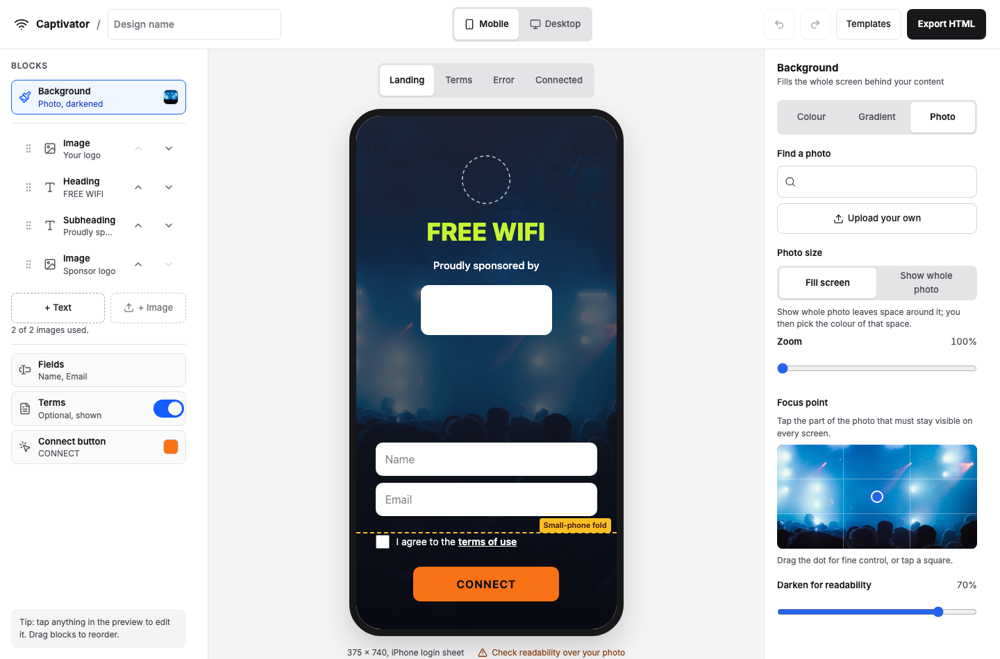

# Captivator

Captivator is an editor for designing a branded guest Wi-Fi splash (captive portal) page, with a live phone and desktop preview, that exports the page as a single standalone HTML file.

**Live:** https://app.captivator.workers.dev (the template picker is at `/` and the editor at `/editor`)



This is the Phase 0 MVP. The [product requirements (PRD)](.project/prd/Captive%20Portal%20Designer%20%E2%80%94%20PRD.md) cover the product, and the [tech spec](.project/spec/Captivator%20MVP%20%E2%80%94%20Tech%20Spec.md) covers this build. Tickets, decisions and reviews are in [`.project/`](.project/).

## Run locally

You need Node 22.23 or newer.

```sh
npm i && npm run dev      # http://localhost:5173
npm test                  # the Vitest suite
npm run build             # runs the tests, then the production build
```

Unsplash photo search is optional locally. To turn it on, copy `.dev.vars.example` to `.dev.vars` and fill in `UNSPLASH_ACCESS_KEY`. Without the key, the dev server prints a "Missing required secrets" warning and photo search says it isn't available. Everything else still works.

**Deploy:** every push to `main` runs [`.github/workflows/deploy.yml`](.github/workflows/deploy.yml). It runs `npm run build`, so a failing test stops the deploy, and then deploys to Cloudflare Workers with vinext. It needs the `CLOUDFLARE_API_TOKEN` and `CLOUDFLARE_ACCOUNT_ID` repository secrets. `UNSPLASH_ACCESS_KEY` must also be set as a secret on the `app` Worker (`npx wrangler secret put UNSPLASH_ACCESS_KEY --name app`). `cloudflare.config.ts` declares the key as a required secret, so a deploy fails without it ([decision](.project/decisions/T-031-secret-set-before-push.md)). Cloudflare creates the KV namespace for the search cache on the first deploy.

## What's in it

**The brief:**

- **Logo upload:** PNG, JPEG, WebP or SVG, with required alt text. Uploads are downscaled in the browser, and SVGs are turned into raster images.
- **Background image or colour:** a solid colour, a two-colour gradient in three directions, or a photo. A photo can fill the screen or show in full, and it has zoom, a focus point (presets or a draggable dot) and a darken slider.
- **Text with colour and size:** heading, subheading and body styles, each with a size slider and a colour picker.
- **Up to two of Name, Email and Phone:** each field gets the right `type`, `autocomplete` and `inputmode`. You can set the input colours.
- **Connect button colours:** button and text colour, solid or outline style, and the label.
- **Live mobile and desktop preview:** a 375×740 phone frame and a 1280×800 browser frame. Both update as you type or drag.

**Extras that shipped:**

- **Templates:** four templates (Blank, Sponsor, Photo hero, Minimal), with live thumbnails. Switching templates keeps your images and text. "Continue your design" reopens your saved work.
- **Saving:** your design saves to `localStorage` and comes back after a refresh. If saving or restoring fails, the editor tells you.
- **Undo and redo:** up to 100 steps, with Cmd/Ctrl+Z. A whole drag counts as one step.
- **Blocks:** add, remove and reorder text and up to two image blocks (for example a logo and a sponsor), using buttons or drag and drop.
- **Terms:** an optional terms checkbox, never pre-ticked, with an editable terms sheet. The placeholder copy is bracketed prompts, not invented legal wording.
- **Guest screens:** a switcher previews Landing, Terms, Error and Connected, all generated from the same design.
- **Readability check:** WCAG contrast warnings, with a one-tap Fix. Over photos the check is approximate, and the message says so.
- **Fit check:** a warning when the page won't fit the iPhone SE login sheet.
- **Logo palette:** colour suggestions taken from your logo.
- **Unsplash search:** search from the Photo tab, with the photographer credit and Unsplash's required download ping.
- **Export HTML:** one file with no JavaScript and no network requests. Every image is inlined, and the background is re-encoded to keep the page near 100 KB. A toast shows the file size, and a page over budget gets a warning but still downloads.

Every check warns and never blocks editing. Every response sends `X-Content-Type-Options`, `Referrer-Policy` and a CSP with `frame-ancestors 'none'`.

## Key decisions

- **A schema-first `Design` with three zones.** One Zod schema defines the design: the background is pinned at the top, the blocks can be reordered, and the form is pinned at the bottom. The schema is the trust boundary, so image and credit URLs are allowlisted by scheme and host ([decision](.project/decisions/general-url-allowlist.md)).
- **One renderer.** `SplashPage` uses inline styles only and has no editor or Next.js imports. The preview, the template thumbnails, the fit check and Export HTML all use it, so they can't drift apart. A `mode` prop (`edit`, `preview` or `export`) changes only what the spec's render-mode table lists ([decision](.project/decisions/general-splashpage-render-mode.md)).
- **Flexbox within the viewport.** The layout is a centred column with `gap` and a spacer above the form, and content is never absolutely positioned. The minimum target is iOS 15.4 ([decision](.project/decisions/general-minimum-ios-version.md)).
- **Downscaling in the browser.** Uploads are resized before they reach the store, which keeps `localStorage` within quota and the export near budget. At export time, every image that isn't already inline is fetched and inlined, and the background is re-encoded ([inlining](.project/decisions/general-export-inlines-all-images.md), [re-encoding](.project/decisions/general-export-background-reencode.md)).
- **A small-phone fit check.** It measures the page at 375px wide against the 600px login sheet on an iPhone SE.
- **vinext on Cloudflare Workers instead of Vercel.** The planned host wasn't available. The code is still a standard Next.js 16 App Router app ([decision](.project/decisions/general-deploy-cloudflare-vinext.md)).

Other decisions that changed scope or departed from the spec:

- **Form target:** a form with guest fields posts to `[PORTAL_SUBMIT_URL]`, never to the router ([decision](.project/decisions/general-export-form-action.md); see the path to production below).
- **Photo credit in the export:** plain text with no links, because a link can't load in the login sheet before sign-in ([decision](.project/decisions/T-006-export-credit-plain-text.md)).
- **Photo overlay:** a top-to-bottom wash between its two colours. The fade-direction control is deferred ([decision](.project/decisions/T-006-overlay-two-stop-wash.md)).
- **Photo contrast:** labelled approximate rather than reported as a pass ([decision](.project/decisions/general-photo-contrast-approximate.md)).
- **Template photo credits:** kept beside the templates, not in the design, and shown on the picker cards ([decision](.project/decisions/T-002-template-photos-and-credits.md)).
- **Unsplash search cache:** results are cached for an hour in vinext's KV-backed data cache, because Workers don't cache on `s-maxage` ([decision](.project/decisions/T-031-search-cached-by-fetch-revalidate.md)).
- **Unsplash rate limit:** each client is throttled to 10 calls per 60 s with a Workers Rate Limiting binding. On the demo tier, one client could still use up the hourly quota, and an IPv6 client could rotate addresses. Both risks are accepted for the demo ([quota](.project/decisions/T-031-unsplash-quota-risk-accepted.md), [IPv6](.project/decisions/T-031-ipv6-rotation-accepted.md)).
- **Stretch work:** scheduled like the rest of the work rather than held back, so all of it shipped ([decision](.project/decisions/general-stretch-tickets-scheduled.md)).
- **Editor layout:** on wide screens, each editor column scrolls independently, so the preview stays in place. This fixes a failure found during the checklist run ([decision](.project/decisions/T-036-columns-scroll-when-side-by-side.md)).

## Path to production

The editor is the first piece. The [PRD](.project/prd/Captive%20Portal%20Designer%20%E2%80%94%20PRD.md#system-context) describes the full system. In short:

- **Peplink external splash, routed on `sn`.** Each router's captive portal profile points once at a fixed URL that we host. The router adds its serial number (`sn`) to the redirect, and the portal service maps it to the active booking and serves that booking's published design. Nothing on the router changes per event.
- **Capture takes two hops.** The guest's form posts to our portal service, which records the details and consent. The service then has the browser post a second form, with `command=login` and no personal data, to the router's `form_action`. Only the two known Peplink hosts are allowed as `form_action`. That's why an export with fields posts to a `[PORTAL_SUBMIT_URL]` placeholder, and only a click-through export posts to `[ROUTER_FORM_ACTION]` ([decision](.project/decisions/general-export-form-action.md)).
- **A portal service on Cloudflare Workers + Hono.** It renders pages on the server at the edge. Designs and the `sn` map live in KV, the current-version pointer and consent records in D1, and there's a per-`sn` rate limit. The MVP already runs on Workers, and `SplashPage` has no editor or Next.js imports, so it can move across unchanged.
- **RADIUS before any data capture.** Click-through can use Open Access. Any flow that collects data switches the router to User Authentication against our own RADIUS server (a FreeRADIUS pair or a hosted service), so only guests with a recorded submission get online. The router gets a one-time opaque token, never personal data.
- **Consent records and terms versions.** Each submission stores the terms version and consent text version the guest accepted, with a timestamp. Marketing opt-in is separate, unticked and recorded per sponsor.
- **Unsplash self-hosting is pending confirmation.** The export inlines a resized copy of the photo, but Unsplash's guidelines expect hotlinking. Before publishing, we need Unsplash's confirmation, or the fallback of allowing its CDN through the walled garden. The exported credit is plain text, so a production portal could link it on the Connected page after sign-in. Search also needs Unsplash production approval and a global quota counter before wider use.

## Next steps and cuts

**Cut:** nothing. No cut was requested. Everything in the spec's cut order shipped (Unsplash search, focus-point drag, the screen switcher, the logo palette and the fit check), and so did the rest of the stretch work (drag to reorder and the one-tap contrast Fix).

**Deferred:** the fade-direction control for the photo overlay. The schema stores no direction, so adding one means a schema version bump and a migration ([decision](.project/decisions/T-006-overlay-two-stop-wash.md)).

**Known gaps from the checklist run.** 14 checks passed and 8 were skipped, which are recorded as unverified ([checklist](.project/review/phone-checklist.md), [decision](.project/decisions/T-029-skipped-checks-unverified.md)). The one failure, where the preview slid down when Unsplash results loaded, has a fix (T-036) that hasn't yet been re-checked in the deployed editor. These remain unchecked on a device, and unit tests are the only evidence for them:

- The image and field limits, and a 4 MB phone photo landing under 150 KB.
- Keyboard-only use, and VoiceOver announcing switch and segmented-control state.
- Opening the exported file on a phone, including `100dvh`.
- The exported terms sheet opening and closing, with the box unticked.
- Native `required` messages and the focus ring.
- Input styling and placeholder readability.
- The page inside a real iOS and Android Wi-Fi login sheet, which needs a router.
- The live URL loading over mobile data.

**What I'd do next:**

1. Run the unverified checks above on real iOS and Android devices, then do the Peplink spike: one router, the fixed splash URL, and a real form-POST login.
2. Build the portal service with `sn` routing, the two-hop submit and consent records, and turn Export into publish and roll back.
3. Apply for Unsplash production approval, and add a global quota counter.
4. Measure photo contrast from the area behind the text instead of the photo's average colour, and add the overlay fade direction.

## Credits

The template photos are from [Unsplash](https://unsplash.com), under the [Unsplash License](https://unsplash.com/license): Sponsor by [Marcel Strauß](https://unsplash.com/@martzzl), Photo hero by [Miguel Dominguez](https://unsplash.com/@migueldominguez) and Minimal by [Woliul Hasan](https://unsplash.com/@shotbywoliul).
